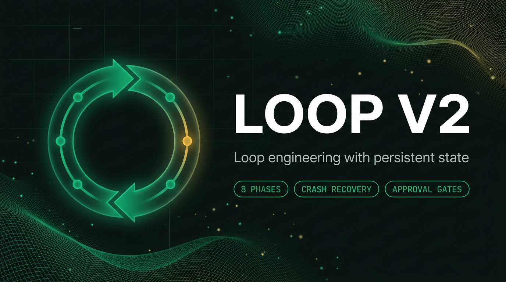

# Sainskerta Loop V2 — TaskFlow Edition



> **Loop Engineering** • **Persistent State** • **Human-in-the-Loop**

Sainskerta Loop V2 adalah metodologi pengembangan project berbasis **loop engineering** — setiap fase project berjalan dalam siklus terstruktur dengan **TaskFlow persistence**, **crash recovery**, dan **human-in-the-loop approval gates**.

```
Prerequisites → Planning → Wireframe → Backend → Frontend → Audit → Deploy → Improvement
                                        ↕                          ↕
                              user_requirement.md          feedback loop
```

---

## ✨ What's New in V2

| Feature | V1 | V2 |
|---------|----|----|
| State management | Shell variables (lost on crash) | **TaskFlow persistent state** |
| Approval gates | Manual check | **Auto wait/resume** via OpenClaw |
| Crash recovery | ❌ Lost progress | **✅ Resume from checkpoint** |
| Sub-agent orchestration | None | **Per-phase Claude Code sub-agents** |
| Logging | Minimal | **Structured logs** |

## 🏗️ 8 Fase

| Fase | Deskripsi | Butuh Approval? |
|------|-----------|:---:|
| `00-PREREQUISITES` | Setup DB, framework, environment | ✅ |
| `01-PLANNING` | Analisa & breakdown arsitektur | ✅ |
| `02-WIREFRAME-AUDIT` | Wireframe → Mockup → Approve | ✅ |
| `03-BACKEND` | Backend coding | ❌ |
| `04-FRONTEND` | Frontend + integrasi API | ❌ |
| `05-AUDIT` | Security, performance, code review | ✅ |
| `06-DEPLOYMENT` | Build, deploy, SSL | ✅ |
| `07-IMPROVEMENT` | Loop maintenance | ❌ |

## 🛠️ Quickstart

### Manual (via bash scripts)

```bash
# 1. Start fresh workflow
./scripts/run-flow.sh --start

# 2. Run phases
./scripts/phase-runner.sh --phase 00-PREREQUISITES

# 3. Check status
./scripts/run-flow.sh --status

# 4. Resume after interruption
./scripts/run-flow.sh --resume
```

### Via OpenClaw (TaskFlow orchestration)

```
Use sainskerta-loop-v2 skill for project: <nama-project>.
Mulai dari fase prerequisites.
```

### Via Claude Code

```
claude-privasimu --allowed-tools "Read(*)" "Write(*)" "Edit(*)" "Bash(*)" \
  -p "Execute phase 03-BACKEND per phases/03-BACKEND.md"
```

## 📁 Struktur Folder

```
sainskerta-loop-workflow-v2/
├── .taskflow/                    ← Persistent state (TaskFlow)
├── phases/                       ← 8 fase development
│   ├── 00-PREREQUISITES.md
│   ├── 01-PLANNING.md
│   ├── 02-WIREFRAME-AUDIT.md
│   ├── 03-BACKEND.md
│   ├── 04-FRONTEND.md
│   ├── 05-AUDIT.md
│   ├── 06-DEPLOYMENT.md
│   └── 07-IMPROVEMENT.md
├── standards/                    ← Standar SSN
│   ├── SAINSKERTA-RULES.md
│   ├── MODULAR-MONOLITH.md
│   ├── UI-UX-STANDARDS.md
│   ├── DATABASE-RULES.md
│   ├── AI-PROVIDERS.md
│   ├── TWELVE-FACTOR.md          ← Twelve-Factor App + rekonsiliasi
│   ├── SRE-RELIABILITY.md        ← SLO, monitoring, restore drill
│   ├── OWASP-ASVS.md             ← Keamanan aplikasi (ASVS 5.0)
│   ├── CORE-WEB-VITALS.md        ← LCP / INP / CLS
│   ├── DATA-PROTECTION-ID.md     ← UU PDP + PP 33/2026
│   ├── TESTING-TDD.md            ← TDD & coverage gate
│   └── ISO-27001-27701.md        ← ISO 27001/27701 (aspirasional)
├── templates/                    ← Template file
│   ├── progress.md
│   ├── user_requirement.md
│   ├── loop.md
│   ├── taskflow-config.json
│   └── prompt-phase.md
├── scripts/                      ← Orchestrator scripts
│   ├── state.sh                  ← State manager
│   ├── phase-runner.sh           ← Phase executor
│   ├── wait-for-approval.sh      ← Approval waiter
│   ├── resume.sh                 ← Checkpoint resume
│   └── run-flow.sh               ← Main orchestrator
├── orchestrator/                 ← TaskFlow orchestration
│   ├── flow-plan.yaml            ← Phase dependency graph
│   └── phase-prompts/            ← Claude Code prompts per fase
├── README.md                     ← Dokumentasi ini
├── CHANGELOG.md
└── MIGRATION.md
```

## 📋 Aturan Utama (Ringkasan)

1. **Modular Monolith** — wajib, no microservices
2. **No foreign keys** — handle di aplikasi
3. **Soft delete & restore** — wajib
4. **CRUD in one page** — right-side drawer modal
5. **Sidebar 1 color icon** — solid, no gradient
6. **No hardcoded dummy data** — semua via database
7. **User wajib kasih akses DB** sebelum create
8. **Backend dulu, baru frontend**
9. **Audit sebelum deploy**

Detail lengkap: [standards/SAINSKERTA-RULES.md](standards/SAINSKERTA-RULES.md)

## 🔄 State Lifecycle (TaskFlow)

Setiap fase mengikuti siklus:

```
pending → running → waiting (if approval needed) → completed
                                                    → failed (retry)
```

State di-manage oleh **OpenClaw TaskFlow runtime** — persistent, crash-safe, dan bisa di-resume kapan saja.

## 🌐 Integrasi AI Provider

Workflow ini mendukung berbagai AI provider:
- **Claude Code** — coding, review, agentic
- **OpenAI GPT** — general reasoning
- **DeepSeek** — low-cost alternative
- **Gemini** — multimodal

Lihat [standards/AI-PROVIDERS.md](standards/AI-PROVIDERS.md).

## 🚀 Cara Migrasi dari V1

Lihat [MIGRATION.md](MIGRATION.md)

## 🎨 Brand & Promotion Kit

Aset marketing siap pakai ada di [`promo/`](promo/) — bebas dipakai ulang
di bawah lisensi MIT yang sama:

| Aset | File | Kegunaan |
| --- | --- | --- |
| Logo mark | `promo/logo.png` | Ikon / avatar (1024x1024) |
| Logo lockup | `promo/logo-wordmark.png` | Docs, header, slide |
| Software box | `promo/software-box.png` | Render produk 3D |
| Poster | `promo/poster.png` | Key art / cetak (portrait) |
| Banner | `promo/banner.png` | Hero wide / header README |
| Social preview | `promo/social-preview.png` | GitHub/Open Graph (1280x640) |
| Feature showcase | `promo/feature-showcase.png` | Grid 4 fitur utama |
| Social square | `promo/social-square.png` | Post IG / X (1:1) |
| Video iklan | `promo/loop-v2-ad-15s.mp4` | Iklan launch 15 detik 1080p + audio |

Palet brand: emerald `#10b981`, gold `#fbbf24`, charcoal `#0c1210`.
Delapan node pada loop = delapan fase; node emas = approval gate (human-in-the-loop).

## 📜 Lisensi

MIT — Open source untuk project development.

---

*Dibuat untuk Sainskerta Solusi Nusantara • 2026*
